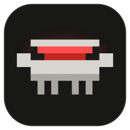
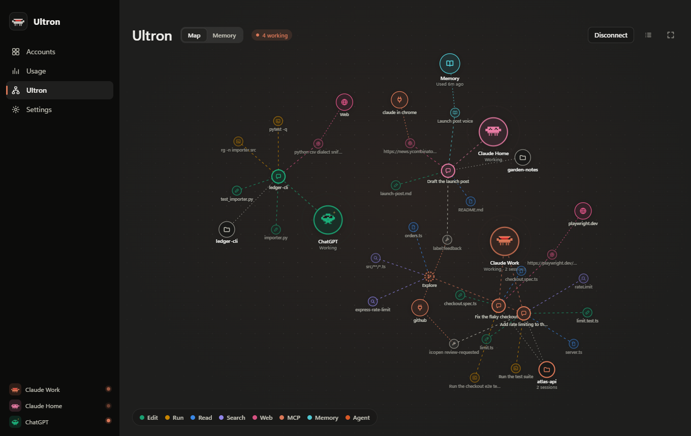
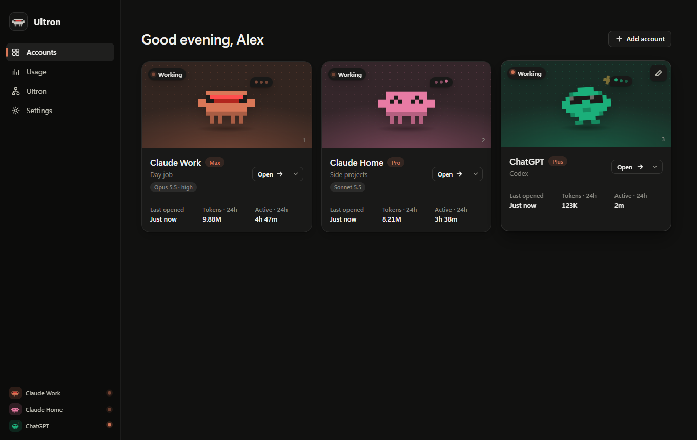
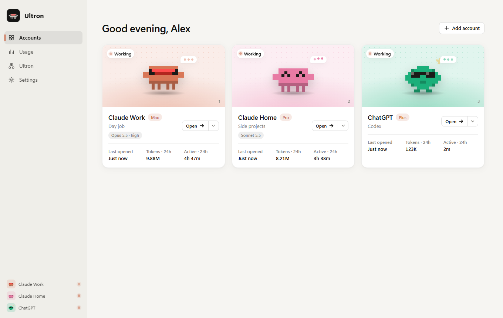
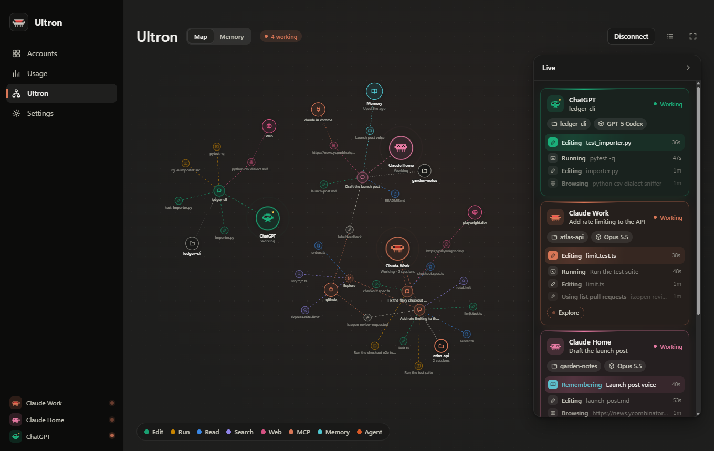
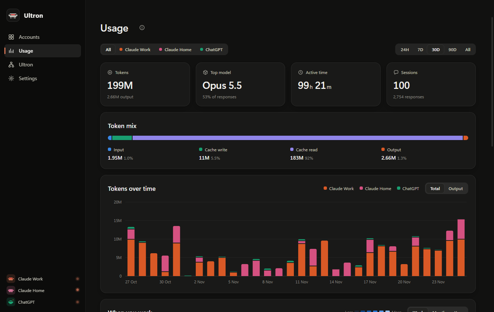
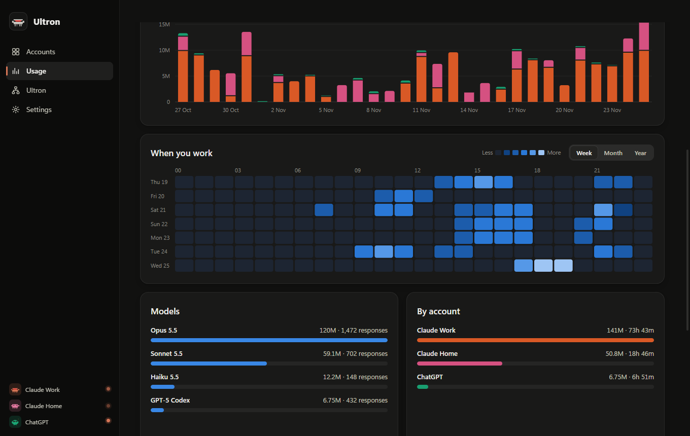
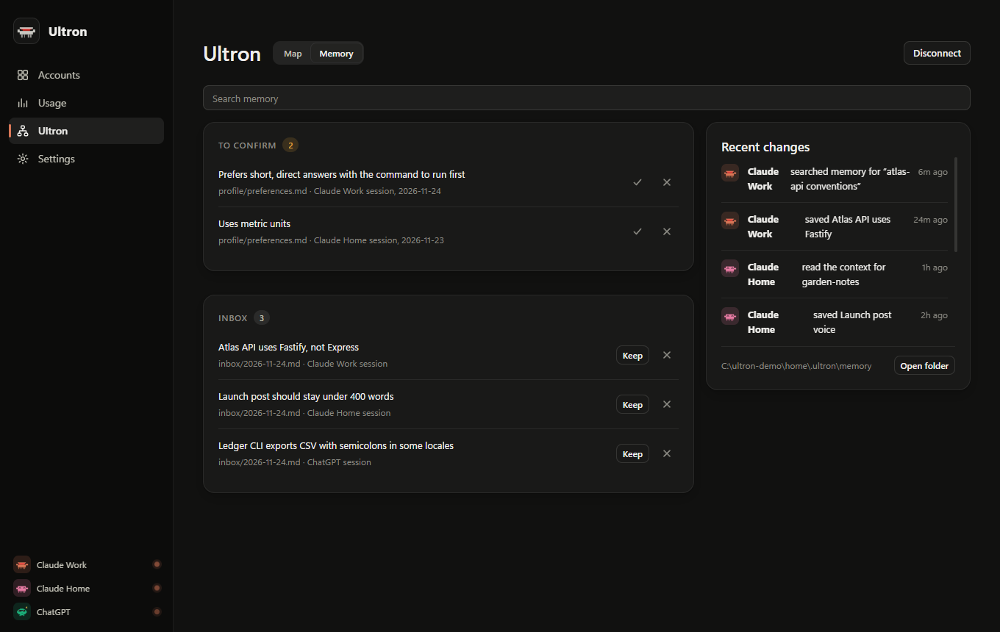

<div align="center">



# Ultron

**A live map, launcher and usage dashboard for your Claude and ChatGPT desktop accounts.**


[Install](#install) · [Using Ultron](#using-ultron) · [Features](#features) · [Development](#development) · [License](#license)

<br>



</div>

> Screenshots on this page show synthetic demo data, not a real account.

## A personal project

Ultron is a personal project. I built it for my own use, on my own PC, to keep track of several Claude and ChatGPT accounts at once. It isn't a product, and nobody is paid to maintain it.

It's shared in case it's useful to you. You're welcome to install it, read it, change it and fork it (it's [MIT licensed](LICENSE)), but please keep your expectations in line with that:

- It comes **as is**, with no warranty and no promise of support, fixes or a roadmap.
- It is built and used on **Windows 11**. Windows 10 isn't tested.
- The installer is **not code-signed**, so Windows will warn you the first time you run it.
- It reads files on your PC (your Claude Code and Codex transcripts) and can edit your agents' config when you press **Connect agents**. That's the point of the app, but read [Privacy](#privacy) before you use it.

Issues and pull requests are welcome, but I may not get to them.

## Features

### Launch every account from one place

One card per account, each with a pixel mascot you can dress up. A card shows whether the account is working, its plan, the last time you opened it, and tokens and active time for the last 24 hours. Click a card, or press `1`–`9`, to open it. The arrow next to **Open** chooses how: desktop app, terminal, VS Code or browser. Ultron remembers the choice per account.

<p align="center">
  
  
</p>

- **Several accounts side by side.** Every account gets its own desktop profile and CLI folder, so two Claude accounts and a Codex account can run together in the app, in the terminal and in VS Code.
- **Plan badges.** Each account's plan (Max, Pro, Plus, Free…) is read from its own CLI without a model call and refreshed every six hours.
- **Model and effort.** Pick a model and effort from the account's own CLI list. The terminal opens with your choice.
- **Gemini and Grok** are launch-only: they open in your browser, with no plan badge and no place on the map.

### Watch what your agents are doing

The Ultron page is a full-window live map. Every account is a node, its sessions hang off it, and each session connects to the folder it works in. Every tool call spawns a node for two minutes, tinted by what it is: edit, run, read, search, web, MCP or agent. Calls to the same MCP server, website or the memory vault meet at one shared node, and sessions in the same folder share that folder's node.

<p align="center">
  
</p>

Drag a node, scroll to zoom, drag the background to pan and double-click it to fit everything. Click an account to open it, a session to open it where it runs (Claude or Codex Desktop, VS Code in its folder, or a terminal with `--resume`), or a folder to open it in Explorer. The **Live** panel lists each session's latest actions, and the full-screen button hides the sidebar (`Esc` leaves).

### See your usage

Tokens, token mix, top model, active time and sessions, with tokens over time, a heatmap of when you work (week, month or year), and breakdowns by model, account and project. Filter by account and by 24H, 7D, 30D, 90D or All.

<p align="center">
  
  
</p>

Usage comes from the Claude Code and Codex sessions stored on this PC. Chat conversations in the apps aren't stored locally, so they aren't counted.

**Several PCs?** Ultron can add up usage across devices. Each device gets its own random id and uploads only hourly and daily token totals (by account and model) to a small server you run yourself; nothing else leaves the PC. Turn it on under **Settings → Devices**, enter a device name, the server URL and a shared token, then switch **Usage** between **This device** and **All devices**. Accounts on different devices are matched by a keyed hash of the account's email, which the server never sees. The server only has to answer two requests (`PUT` and `DELETE` on `/v1/devices/<id>`, both with a bearer token); a Cloudflare Worker with KV storage does it in about 60 lines, and you host it yourself.

### Share one memory between agents

**Connect agents** gives Claude Code and Codex the **Ultron Hub**: one vault of plain Markdown per device that every agent reads at the start of a task and writes outcomes, decisions and facts to. Facts about you wait under **To confirm** or in the **Inbox** until you review them on the Memory tab. Agents can also message each other.

<p align="center">
  
</p>

Connecting also installs the `kiss` and `repo-structure` skills for each agent. **Disconnect** removes everything it added. **Keep memory tidy** lets a chosen account write sessions up after they end and review the vault weekly.

## Install

You need Windows and at least one of the [Claude](https://claude.ai/download) or [ChatGPT](https://chatgpt.com/download) desktop apps. Claude Code and Codex are optional, but usage, plans, models and the live map all come from them.

### Option 1: the installer

1. Open [Releases](../../releases/latest) and download `Ultron-Setup-<version>.exe`.
2. Run it. If Windows shows "Windows protected your PC", choose **More info → Run anyway** (the installer isn't signed).
3. Ultron installs for your user only (no admin needed) and adds Desktop and Start Menu shortcuts.
4. Open Ultron and follow setup.

Ultron checks for updates every six hours and shows **Update ready · Restart** at the bottom of the sidebar.

### Option 2: run it from source

Requires [Node.js](https://nodejs.org) 22 or later and Git. Keep the checkout on a short path (for example `C:\dev\ultron`): Windows' 260-character limit breaks Electron otherwise.

```powershell
git clone <repository-url> ultron
cd ultron
npm install
npm start
```

To build the installer yourself:

```powershell
npm run package        # writes dist/Ultron-Setup-<version>.exe
```

## Using Ultron

**First run.** Setup has four steps and every one can be skipped. **Settings → Run setup again** brings it back.

1. **Apps:** shows which of Claude Desktop, Claude Code, ChatGPT Desktop, Codex and Git are installed. A missing app has an **Install** link to its official page, and where a one-line install exists the exact command is shown. Nothing installs until you click **Run**.
2. **Accounts:** sign in to each account.
3. **Memory:** create a new vault or choose an existing folder, and choose whether to connect your agents.
4. **Ready:** open Ultron.

**Add another account.** Choose **Add account**, pick the service, sign in to its desktop app and terminal, and give it a look. Each new account gets its own CLI folder under `~/.ultron/homes`. ChatGPT Desktop holds one account, so extra ChatGPT accounts open in the CLI.

**Day to day.**

| Do this | To get this |
| --- | --- |
| Click a card, or press `1`–`9` | Open that account the way you chose |
| Click the arrow next to **Open** | Choose desktop app, terminal, VS Code or browser |
| `Ctrl+1` / `Ctrl+2` / `Ctrl+3` | Go to Accounts / Usage / Ultron |
| `Ctrl+,` | Open Settings |
| Click a node on the map | Open that account, session or folder |
| **Connect agents** on the Ultron page | Share memory and messages between Claude Code and Codex |
| **Settings** | Name, theme, minimize after opening, setup, memory folder and tidying, updates |

**What Ultron can't see.** Chat conversations, because only Claude Code and Codex sessions are stored on your PC. And free plans' limits and usage: a free account can be launched and counted, but it can't run the memory curator.

## Privacy

Everything stays on your PC. Ultron has no server and no telemetry.

- Usage is read from `~/.claude/projects` and `~/.codex/sessions` (and from each account's own CLI folder). Nothing is uploaded.
- Plans and models come from asking each account's own CLI. No model call is made. A missing CLI falls back to the plan field of its credentials file; nothing else in that file is read.
- The memory vault is plain Markdown in a folder you choose. Notes that look like secrets are refused.
- The only requests Ultron makes itself are the update check against this repository's GitHub Releases and, if you turn on device sharing, the usage totals it sends to the server you set up. The sync token is stored encrypted with Windows' own protection, in its own file.
- **Connect agents** edits your agents' own config (`~/.claude.json`, `~/.codex/config.toml`, each home's `CLAUDE.md` or `AGENTS.md` and, for Claude, a `SessionStart` hook). **Disconnect** undoes it.

## Development

```powershell
npm install
npm start              # run the app
npm test               # unit tests (usage parsing, scanning, aggregation)
npm run lint:personal  # fail on personal details in the repo
npm run icon           # regenerate build/ultron.ico and build/ultron.png (Python + Pillow)
npm run package        # build dist/Ultron-Setup-<version>.exe
```

The stack is Electron 39 with no framework and no bundler: CommonJS in the main process, vanilla ES modules in the renderer, `node:test` for tests and `electron-builder` for the installer. Tests use synthetic fixtures. Never point development at your real memory vault; use a temporary folder.

<details>
<summary>Project layout</summary>

| Path | Contents |
| --- | --- |
| `src/main/` | App lifecycle, IPC, config, profile detection, "Open with" targets, plan detection scheduler, updater |
| `src/main/usage/` | Incremental transcript scanning, parsing, attribution and aggregation |
| `src/hub/` | Ultron Hub MCP server, the shared CLI table (`cli.js`), the memory vault (`memory.js`, `vault/` skeleton) and the skills shipped to every agent |
| `src/renderer/` | Vanilla ES-module UI: `lib/` shared helpers, `pages/` one module per page |
| `test/` | `node:test` suites with synthetic fixtures |
| `tools/` | Icon generator, personal-details check, screenshot driver |

Config and the usage cache live in `%APPDATA%\Ultron`. The hub keeps its account roster, messages and default memory folder in `.ultron` in your user folder.

</details>

<details>
<summary>Ultron Hub tools</summary>

Connecting registers `ultron-hub` in `~/.claude.json` and `~/.codex/config.toml` (and in any account's own CLI folder) and copies the skills into each agent's `skills` folder. Agents start the server through Ultron's executable, so Node isn't required.

| Tool | Does |
| --- | --- |
| `crew` | Lists the accounts with their plan and model, and who is working |
| `context` | The durable memory plus the current project's overview and state |
| `recall` / `remember` | Search the vault; save a note of a given kind (fact, profile, area, project-state, decision, session, inbox) |
| `update` / `forget` | Replace a stale note or archive it; the old version is always kept |
| `send_message` / `check_inbox` | Message an agent by name or `everyone`, and read replies |

</details>

### Releasing

Pushing a version tag makes GitHub Actions build the installer and publish the release, which is also what the in-app updater reads:

```powershell
git tag v1.2.0
git push origin v1.2.0
```

## License

Ultron is released under the [MIT License](LICENSE): do what you like with it, but it comes with no warranty.

Ultron is an independent project. It isn't affiliated with, endorsed by or sponsored by Anthropic or OpenAI. Claude, Claude Code, ChatGPT and Codex are trademarks of their respective owners.
